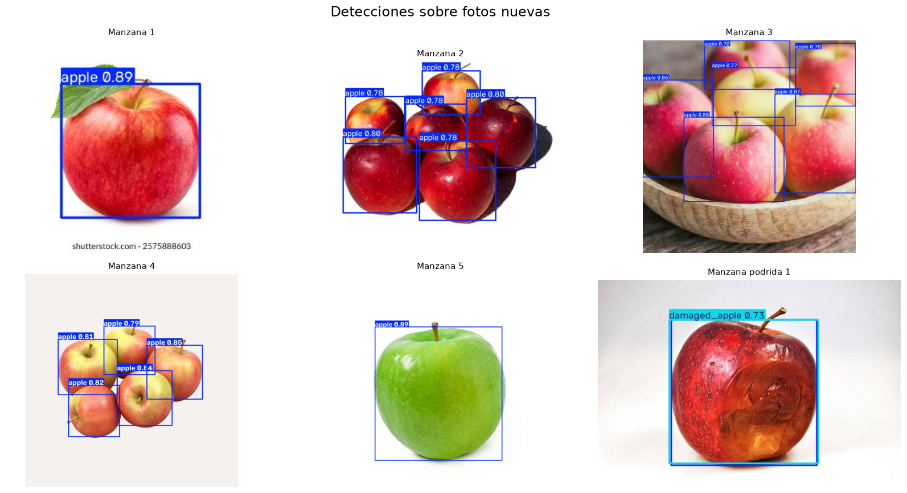

# Detector de manzanas con YOLO26



Detecta manzanas en imágenes y las clasifica como `apple` o `damaged_apple`.

[▶ Más ejemplos](demo/video_cuadros.png) · [📓 Notebook](notebook.ipynb) · [💻 Código en GitHub](https://github.com/DrrFunky/yolo-manzanas-portafolio) · [🌐 Ver demo web](https://huggingface.co/spaces/DrrFunky/yolo-manzanas)

<details>
<summary>Resultado en test</summary>

Modelo: fine tuning · mAP50 **0,687** · mAP50-95 **0,474** · Precision **0,592** · Recall **0,697** · [Captura](demo/resultado_test.png)

</details>

<details>
<summary>Ejecutar localmente</summary>

```powershell
pip install -r requirements.txt
python app.py
```

</details>

Universidad Bernardo O'Higgins · Evaluación 03

**Contribuidores:** [Lucas Benítez](https://github.com/Ariel1224L) · [Martín Durán](https://github.com/Kuzub0) · Alonso Plane

Licencia del código: MIT · Dataset: *Apple Sorting v2* (Roboflow Universe, CC BY 4.0).
